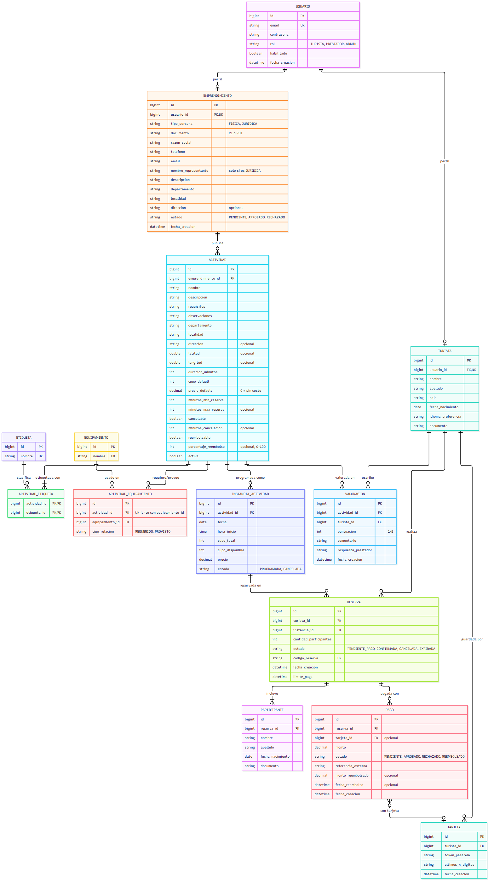
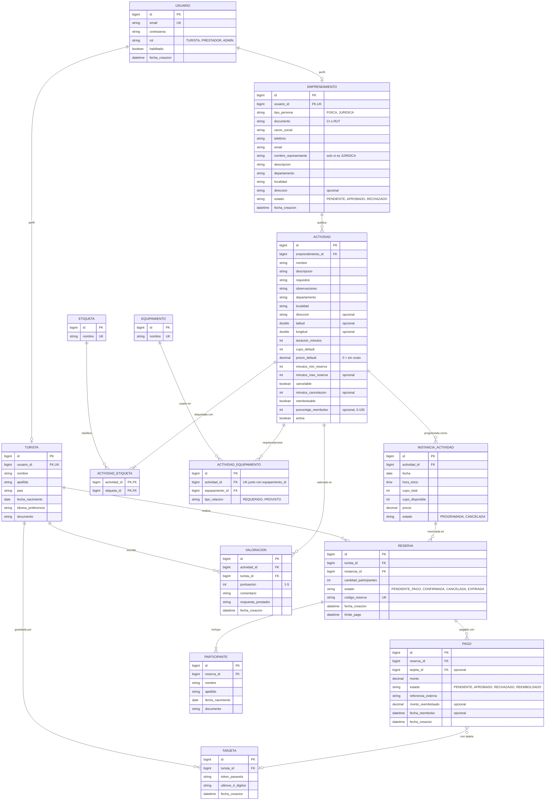
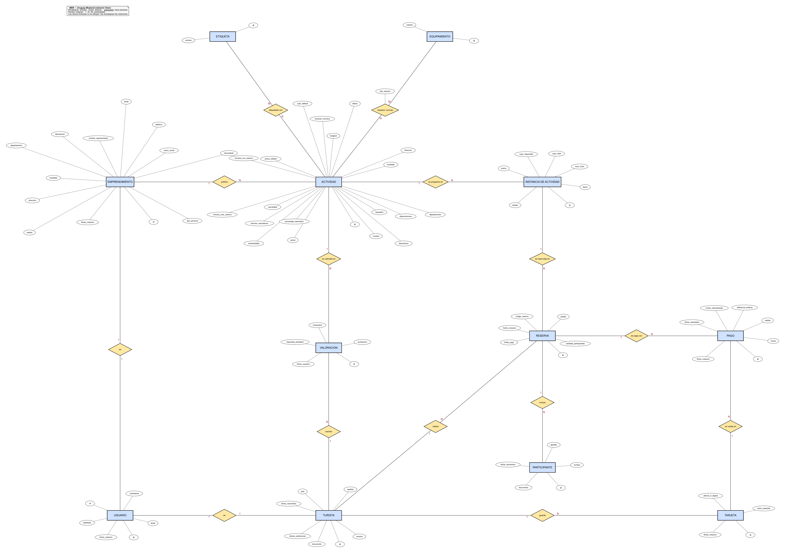

# Modelo Entidad-Relación (MER) — Uruguay Mnatural

Basado en el enunciado del proyecto (`Proyecto TIC 2026.pdf`) y en las reglas de negocio
relevadas en el acta de reunión con el cliente del 14/09/2026.

> **Nota sobre idioma:** este documento (y el diagrama) usan nombres en español, como el
> resto de la documentación del proyecto. El código Java usa los mismos nombres traducidos
> al inglés (`USUARIO` → `User`, `EMPRENDIMIENTO` → `Business`, `RESERVA` → `Booking`, etc.),
> tal como exige la consigna ("nombres en inglés" en el estilo de código). La tabla de
> equivalencias está al final de este documento.

## Diagrama

Fuente del diagrama (Mermaid, para editar)

### Versión en notación Chen

Mismo modelo dibujado con rectángulos (entidades), óvalos (atributos, clave primaria
subrayada), rombos (relaciones) y cardinalidades 1 / N / M. En esta notación no se dibujan
las claves foráneas (las reemplazan las relaciones), y `ACTIVIDAD_ETIQUETA` /
`ACTIVIDAD_EQUIPAMIENTO` aparecen como las relaciones N:M *etiquetada con* y
*requiere / provee* (esta última con su atributo `tipo_relacion`).

## Entidades y justificación de negocio

Cada decisión cita su fuente: **[E]** = enunciado (`Proyecto TIC 2026.pdf`),
**[A]** = acta de reunión con el cliente (14/09/2026).

### USUARIO
Tabla de autenticación base, compartida por los tres tipos de usuario (`rol`). Separarla de
`TURISTA`/`EMPRENDIMIENTO` evita duplicar email/contraseña y permite que un admin
habilite/deshabilite el acceso (`habilitado`) sin borrar el perfil. Esto es clave para el flujo de
aprobación de emprendimientos ("mientras el admin no le de ok no puede logearse" [A]).

### TURISTA
Datos pedidos al registrarse: "nombre, apellido, pais, fecha nac, idioma de preferencia y
documento" [A]. `usuario_id` es único: cada usuario tiene como máximo un perfil de turista.

### EMPRENDIMIENTO
- **Datos de alta:** "persona fisica o juridica, ci o rut y razon social, telefono, correo
  electronico, persona que es representante si es persona juridica" [A].
- **Ubicación y descripción:** el prestador registra "datos de identificación, contacto,
  **ubicación** y una **descripción general** de los servicios ofrecidos" [E]. Por eso están
  `descripcion`, `departamento`, `localidad` y `direccion` (texto libre, sin catálogo cerrado [A]).
- **Aprobación:** `estado` implementa el flujo: el admin ve "emprendimientos pendientes",
  acepta o deniega [A], y `usuario.habilitado` queda en `false` hasta `estado = APROBADO`.
- **Un emprendimiento por usuario:** "como persona fisica solo podes tener uno"; para otro
  emprendimiento se usa otro usuario [A]. `usuario_id` es único.

### ACTIVIDAD
- **Información a publicar:** "el emprendimiento responsable, la ubicación, una descripción
  de la experiencia, **duración aproximada**, precio, características de la actividad y
  cualquier información relevante para el turista, como requisitos de edad, equipamiento
  necesario o equipamiento proporcionado" [E]. La duración se guarda en
  `duracion_minutos`; los requisitos de edad van en `requisitos`.
- **Ventana de reserva:** `minutos_min_reserva` es el mínimo de minutos antes del inicio
  para reservar ("de indicarse cero minutos, el límite es la hora de inicio" [E]);
  `minutos_max_reserva` es la máxima anticipación (opcional).
- **Cancelación:** `cancelable`, `minutos_cancelacion`, `reembolsable` y
  `porcentaje_reembolso` modelan el proceso del cliente: "pones si se puede cancelar o no,
  si le decís que si, le pones un tiempo en minutos [...] con reembolso o sin reembolso [...]
  cuánto porcentaje de rembolso" [A].
- **Valores por defecto:** "le podes poner a la actividad un precio por defecto. Entre
  semana puede salir más barato que el finde" [A]. `precio_default` y `cupo_default` son
  valores por defecto que cada `INSTANCIA_ACTIVIDAD` puede sobrescribir. El precio puede ser
  0, porque el pago solo aparece "si tiene costo" [A].
- **Ubicación:** `departamento` y `localidad` son obligatorios porque la API pública debe
  listar "todas las actividades en un día para cierto Departamento / Localidad" [E]. Van
  como texto libre (el cliente no quiere catálogo cerrado) y las coordenadas son un
  agregado opcional [A].

### ETIQUETA / ACTIVIDAD_ETIQUETA
Catálogo administrado centralmente con alta, consulta, modificación y eliminación por el
admin ("tipos de actividad turística" [E]). La relación con `ACTIVIDAD` es N:M ("pertenecer
(o ser 'etiquetadas') a diferentes categorías" [E]), resuelta con la tabla
`ACTIVIDAD_ETIQUETA`. Cada actividad tiene **al menos una** etiqueta ("puede tener tags (por
lo menos 1 (trekking))" [A]). Por eso la cardinalidad del lado de la actividad es `|{`
(uno o más).

### EQUIPAMIENTO / ACTIVIDAD_EQUIPAMIENTO
`EQUIPAMIENTO` es un catálogo central ("tipos de equipamiento como casco, chaleco
salvavidas..." [E]). `ACTIVIDAD_EQUIPAMIENTO` es la entidad de asociación N:M con
`tipo_relacion`, que distingue el "equipamiento necesario" (`REQUERIDO`) del "equipamiento
proporcionado por el prestador" (`PROVISTO`) [E]. El par (`actividad_id`, `equipamiento_id`)
es único.

### INSTANCIA_ACTIVIDAD
- **Fechas concretas:** "el sistema deberá contemplar la existencia de fechas y horarios
  concretos asociados a una actividad" [E]; "es distinto a calendarizar la actividad" [A].
  Cada instancia tiene su propio cupo ("la cantidad de personas que puede participar en
  cada instancia" [E]) y su propio precio.
- **Cancelación:** `estado = CANCELADA` permite cancelar una instancia puntual (ejemplo:
  "la actividad no puede realizarse bajo la lluvia" [A]) **sin borrar el registro**, para
  rastrear el reembolso del 100% a los turistas con reserva.
- **Posponer:** no es un estado propio. El cliente indicó que los cambios se hacen "solo con
  cancelacion, el proveedor tiene que reembolsar a todos" [A]. Posponer es entonces cancelar
  la instancia y crear una nueva.

### RESERVA
- **Pendiente de pago:** `estado = PENDIENTE_PAGO` se crea al lockear el cupo ("estilo
  pagina de avion" [A]).
- **Plazo de pago:** `limite_pago` sostiene la regla "si el pago no es exitoso, la reserva
  queda en pendiente por 24 horas (1440 minutos) y a las 24 hs se cancela" [A].
- **Código:** `codigo_reserva` es el código que se envía por correo al confirmar [A].
- **Participantes:** `cantidad_participantes` lo indica el turista al reservar [E]; no hay
  otro máximo que el cupo ("lo define los cupos" [A]).

### PARTICIPANTE
En el flujo de reserva, después de elegir la cantidad de cupos "pide datos: nombre apellido
fecha nac ci" [A]. Como esos datos del turista ya se piden al registrarse, se interpretan
como los datos **de cada persona** de la reserva: una fila por cupo.
*Interpretación a confirmar con el cliente.*

### TARJETA
"se agrega/selecciona y guarda el nro tarjeta en el sistema" [A]: el turista puede guardar
tarjetas y elegir una. Por seguridad (estándar PCI) **no** se guarda el número completo,
solo el token que devuelve la pasarela de pagos (sandbox) y los últimos 4 dígitos para
mostrarla.

### PAGO
- **Pasarela externa:** el pago se procesa "mediante la integración con un servicio externo
  de pagos" [E]. `referencia_externa` guarda la referencia que devuelve el sandbox.
- **Varios intentos:** la relación con `RESERVA` es **1:N** porque un pago rechazado deja la
  reserva pendiente 24 h [A] y el turista puede volver a intentar. Cada intento es un
  `PAGO`, y la reserva se confirma solo con uno `APROBADO` ("evitando confirmar una
  operación cuando el pago no haya sido procesado satisfactoriamente" [E]). Una actividad
  sin costo no genera pagos.
- **Reembolsos:** `monto_reembolsado`, `fecha_reembolso` y el estado `REEMBOLSADO`
  registran las devoluciones: el porcentaje de la actividad si cancela el turista, y el
  100% si cancela el prestador o el admin elimina la actividad [A].

### VALORACION
- **Sobre la actividad:** el turista "podrá compartir su experiencia mediante un comentario
  y una valoración de uno a cinco puntos" de la actividad [E]. Por eso `VALORACION` se
  relaciona directamente con `ACTIVIDAD` (`actividad_id`) y con el `TURISTA` que la
  escribe (`turista_id`). Corrección del profesor sobre la versión anterior, que la
  colgaba de la `RESERVA`: "valoracion mer va sobre actividad".
- **Solo quien participó:** "una vez que haya participado de una actividad" [E] es una
  regla de negocio, no del esquema. Al crear la valoración se controla que el turista
  tenga una `RESERVA` `CONFIRMADA` de una instancia ya realizada de esa actividad.
- **Edición y respuesta:** el turista puede editarla o borrarla y el prestador puede
  responder (`respuesta_prestador`), sin moderación por ahora [A].

## Notas fuera del MER (reglas de negocio, no de esquema)

- Cancelación por el turista: reembolso según `porcentaje_reembolso` de la actividad; sin
  reembolso configurado, no hay devolución [A].
- Cancelación por el prestador de una instancia con reservas: devolución del 100% a todos
  los turistas afectados y notificación de la cancelación [A].
- No-show del turista: no genera penalidad ni reembolso especial ("como si hubiera ido") [A].
- No hay límite de reservas por turista [A].
- Valorar requiere haber participado: una `RESERVA` `CONFIRMADA` del turista en una
  instancia ya realizada de la actividad [E].
- El admin puede eliminar una actividad inapropiada; si tenía reservas, el prestador
  reembolsa el 100% [A].
- Las operaciones de la API pública [E] salen del esquema:
  - Listado de emprendimientos: `EMPRENDIMIENTO`.
  - Actividades de un día por departamento/localidad: `INSTANCIA_ACTIVIDAD.fecha` +
    `ACTIVIDAD.departamento/localidad`.
  - Top 3 del mes por departamento: `VALORACION` (por `fecha_creacion`) → `ACTIVIDAD`.
  - Verificar emprendimiento: `EMPRENDIMIENTO.estado`.
  - Búsqueda por palabra clave: `ACTIVIDAD.nombre/descripcion`.

## Equivalencia con las entidades del código (Java, en inglés)

| Español (MER)              | Inglés (código)          |
|----------------------------|--------------------------|
| USUARIO                    | `User`                   |
| TURISTA                    | `Tourist`                |
| EMPRENDIMIENTO             | `Business`               |
| ACTIVIDAD                  | `Activity`               |
| ETIQUETA                   | `Tag`                    |
| ACTIVIDAD_ETIQUETA         | tabla `activity_tags` (`@ManyToMany`) |
| EQUIPAMIENTO               | `Equipment`              |
| ACTIVIDAD_EQUIPAMIENTO     | `ActivityEquipment`      |
| INSTANCIA_ACTIVIDAD        | `ActivitySchedule`       |
| RESERVA                    | `Booking`                |
| PARTICIPANTE               | `BookingParticipant`     |
| TARJETA                    | `Card`                   |
| PAGO                       | `Payment`                |
| VALORACION                 | `Review`                 |
