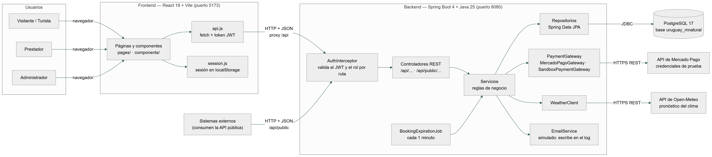
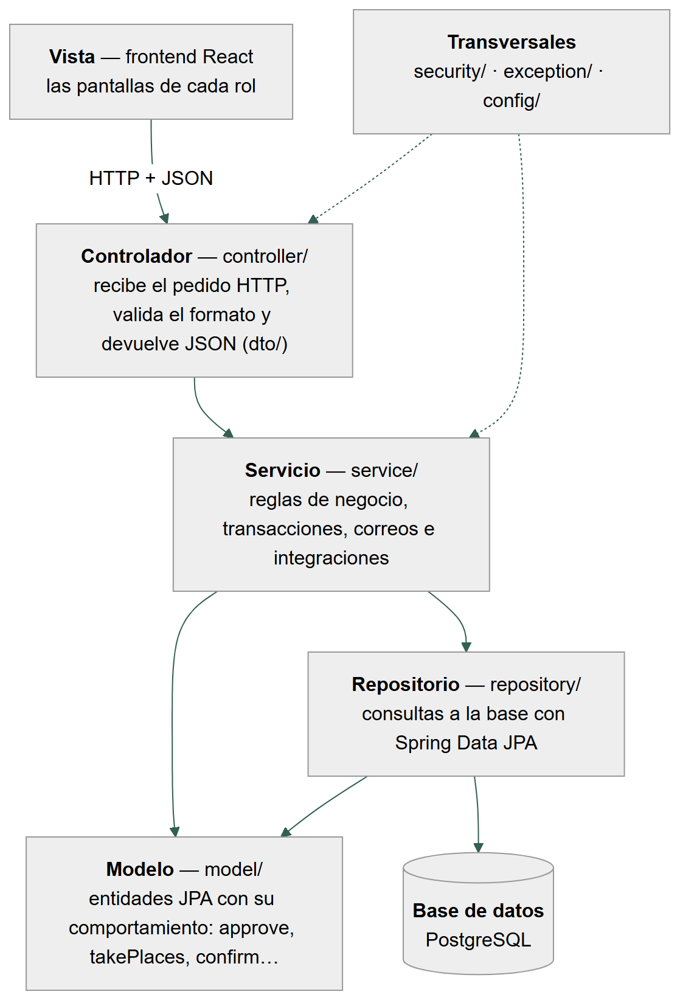
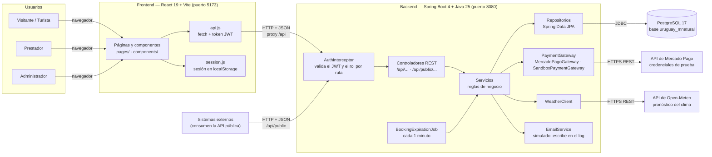
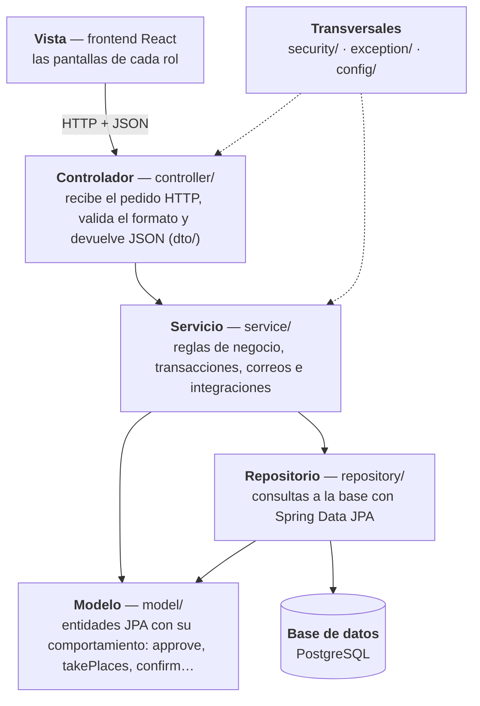

# Diseño de la arquitectura — Uruguay Mnatural

## 1. Resumen

Uruguay Mnatural es una aplicación web con **frontend y backend separados** que se comunican por
una **API REST con JSON**:

- **Frontend:** una aplicación de una sola página (SPA) en React. Es lo que ve el usuario en el
  navegador.
- **Backend:** una aplicación Spring Boot que tiene toda la lógica de negocio, controla los
  permisos, guarda los datos en PostgreSQL y se conecta con los servicios externos.
- **Servicios externos:** Mercado Pago (pagos, en modo de prueba) y Open-Meteo (pronóstico del
  clima). Otros sistemas pueden consultar la API pública del backend.

## 2. Componentes

| Componente | Tecnología | Responsabilidad |
|---|---|---|
| Frontend | React 19, React Router 7, Vite | Pantallas de cada rol, validación inicial de formularios, guarda la sesión (token) en el navegador |
| Backend | Java 25, Spring Boot 4.1, Maven | API REST, reglas de negocio, seguridad, transacciones |
| Base de datos | PostgreSQL 17 | Datos persistentes; el esquema lo genera Hibernate/JPA a partir del modelo |
| Pagos | API REST de Mercado Pago | Tokenizar la tarjeta, cobrar y reembolsar. Uruguay Mnatural nunca guarda el número completo de la tarjeta |
| Clima | API REST de Open-Meteo | Pronóstico de cada fecha de una actividad |
| Correo | `EmailService` | En esta versión es simulado: escribe el correo en el log del backend |

## 3. Patrón MVC en capas

El backend sigue el patrón **MVC en capas** que pide la consigna. Cada capa solo usa a la de
abajo:

| Capa | Paquete | Qué hace | Ejemplo |
|---|---|---|---|
| Vista | frontend React | Muestra los datos y captura lo que hace el usuario | `BookingPage.jsx` |
| Controlador | `controller/` | Recibe el pedido HTTP, convierte el JSON en un DTO y llama al servicio. No tiene reglas de negocio | `BookingController` |
| Servicio | `service/` | Reglas de negocio y transacciones (`@Transactional`), correos e integraciones externas | `BookingService.hold()` |
| Modelo | `model/` | Entidades JPA con su estado y su comportamiento | `ActivitySchedule.takePlaces()` |
| Repositorio | `repository/` | Acceso a la base con Spring Data JPA | `ActivityScheduleRepository.findByIdForUpdate()` |
| DTO | `dto/` | Objetos que viajan en el JSON, separados de las entidades para no exponer datos internos (por ejemplo, la contraseña) | `BookingDto` |

Paquetes transversales:

| Paquete | Contenido |
|---|---|
| `security/` | `JwtService` (crea y valida los tokens) y `AuthInterceptor` (exige sesión y controla el rol de cada ruta) |
| `exception/` | Excepciones de negocio y `ApiExceptionHandler`, que las convierte en respuestas HTTP con un mensaje en español |
| `config/` | Configuración: contraseñas con BCrypt, registro del interceptor, tareas programadas y el administrador inicial |
| `sandbox/` | Servicio de pagos simulado, alternativa a Mercado Pago para trabajar sin conexión |

El detalle de las clases del modelo está en el [diagrama de clases](Diagrama_de_clases.md), y el
de cómo colaboran las capas en los [diagramas de secuencia](Diagramas_de_secuencia.md).

## 4. Seguridad y permisos

- **Contraseñas:** se guardan con hash BCrypt, nunca en texto.
- **Sesión:** al iniciar sesión el backend devuelve un **token JWT** firmado que vence en 8 horas.
  El frontend lo manda en cada pedido en el encabezado `Authorization: Bearer ...`.
- **Roles por ruta:** `AuthInterceptor` revisa cada pedido:

| Ruta | Quién puede |
|---|---|
| Las demás: portal (`/api/activities`, `/api/tags`, `/api/equipment`), `/api/public/...`, `/api/auth/...` y los registros | Cualquiera, sin sesión |
| `/api/account/...` | Cualquier usuario con sesión |
| `/api/tourist/...` | Solo turistas |
| `/api/provider/...` | Solo prestadores |
| `/api/admin/...` | Solo administradores |

- **Datos propios:** además del rol, los servicios controlan que cada uno vea y cambie solo lo
  suyo (por ejemplo, un prestador solo ve las reservas de sus actividades).
- **Tarjetas:** solo se guardan el token que da Mercado Pago y los últimos 4 dígitos.

## 5. Decisiones de diseño importantes

| Decisión | Por qué |
|---|---|
| Retención de lugares con bloqueo de fila (`SELECT ... FOR UPDATE`) | Dos turistas que reservan los últimos lugares al mismo tiempo no pueden sobrepasar el cupo |
| Tarea programada cada 1 minuto (`BookingExpirationJob`) | Libera los lugares de las reservas pendientes que vencieron, sin intervención de nadie |
| Llamado al servicio de pagos fuera de las transacciones | El pago puede demorar hasta 1 minuto; así no se bloquea la base mientras tanto |
| Interfaz `PaymentGateway` con dos implementaciones | Se puede cambiar Mercado Pago por el sandbox propio con una propiedad (`payments.provider`), sin tocar los servicios |
| El clima se pide aparte del detalle | Si Open-Meteo no responde, la página de la actividad se muestra igual (sin el pronóstico) |
| Baja lógica de actividades y prestadores | Se conserva el historial de reservas y pagos |

## 6. Ejecución y despliegue

En esta versión todo corre en una sola máquina:

| Pieza | Cómo se ejecuta | Dirección |
|---|---|---|
| Frontend | `npm run dev` en `frontend/` | http://localhost:5173 |
| Backend | `mvnw spring-boot:run` en `backend/` | http://localhost:8080 |
| Base de datos | PostgreSQL 17 instalado localmente | localhost:5432, base `uruguay_mnatural` |

En desarrollo, Vite redirige al backend todo pedido que empieza con `/api`, así el navegador ve
un único origen. Las credenciales de prueba de Mercado Pago van en `backend/secrets.properties`,
que no se sube a Git. Sin ese archivo se puede usar el sandbox propio con
`PAYMENTS_PROVIDER=sandbox`.

La API REST completa está documentada en [`../API.md`](../API.md).

Fuente de los diagramas (Mermaid, para editar)

