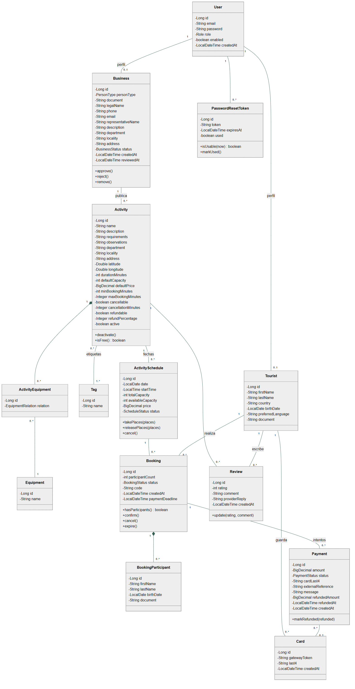
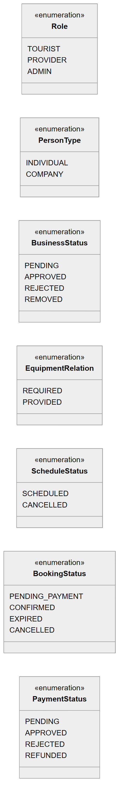
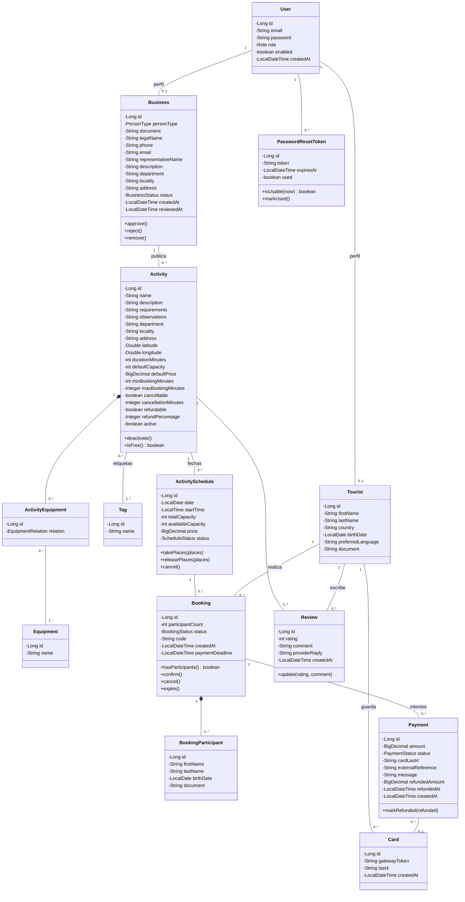
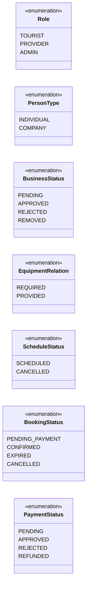

# Diagrama de clases del modelo (UML) — Uruguay Mnatural

Clases del paquete `model/` del backend (`com.uruguaymnatural.backend.model`): las entidades JPA
que se guardan en PostgreSQL, con sus atributos, sus métodos de negocio y las relaciones entre
ellas.

> **Idioma:** como exige la consigna, el código usa nombres en inglés. La equivalencia con el MER
> (en español) está en [`../MER.md`](../MER.md): `User` = USUARIO, `Tourist` = TURISTA,
> `Business` = EMPRENDIMIENTO, `Activity` = ACTIVIDAD, `ActivitySchedule` = INSTANCIA_ACTIVIDAD,
> `Booking` = RESERVA, `BookingParticipant` = PARTICIPANTE, `Card` = TARJETA, `Payment` = PAGO,
> `Review` = VALORACION, `Tag` = ETIQUETA, `Equipment` = EQUIPAMIENTO.

## Clases y relaciones

Imagen vectorial: [`img/Diagrama_de_clases.svg`](img/Diagrama_de_clases.svg)

## Enumeraciones

Los estados y tipos fijos son enumeraciones de Java, guardadas en la base como texto
(`@Enumerated(EnumType.STRING)`).

## Cómo leer el diagrama

- `-` atributo privado, `+` método público. Los getters y setters no se dibujan.
- Una línea entre dos clases es una **asociación**. Los números indican la multiplicidad: `1`,
  `0..1`, `0..*` (cero o más), `1..*` (uno o más).
- El rombo negro (`*--`) es una **composición**: la parte no existe sin el todo. Por ejemplo, los
  participantes (`BookingParticipant`) se borran con su reserva.

## Relaciones

| Relación | Multiplicidad | Significado |
|---|---|---|
| User — Tourist | 1 a 0..1 | Un usuario con rol turista tiene su perfil de turista |
| User — Business | 1 a 0..1 | Un usuario con rol prestador tiene su emprendimiento |
| User — PasswordResetToken | 1 a 0..* | Enlaces para recuperar la contraseña (vencen a los 30 minutos) |
| Business — Activity | 1 a 0..* | Un emprendimiento publica sus actividades |
| Activity — Tag | 0..* a 1..* | Toda actividad tiene al menos una etiqueta |
| Activity ◆ ActivityEquipment — Equipment | 1 a 0..* | Equipamiento de la actividad, marcado como REQUIRED (lo lleva el turista) o PROVIDED (lo da el prestador) |
| Activity — ActivitySchedule | 1 a 0..* | Las fechas y horas concretas, cada una con su cupo y su precio |
| ActivitySchedule — Booking | 1 a 0..* | Las reservas de cada fecha |
| Tourist — Booking | 1 a 0..* | Las reservas que hizo el turista |
| Booking ◆ BookingParticipant | 1 a 0..* | Los datos de cada persona que va |
| Booking — Payment | 1 a 0..* | Cada intento de pago queda registrado, aprobado o no |
| Tourist — Card | 1 a 0..* | Tarjetas guardadas: solo el token del servicio de pagos y los últimos 4 dígitos |
| Payment — Card | 0..* a 0..1 | La tarjeta guardada con la que se pagó, si fue una guardada |
| Activity — Review / Tourist — Review | 1 a 0..* | Una valoración por turista y actividad |

## Comportamiento en el modelo

Las reglas que cambian el estado de una entidad están en la propia clase y no repartidas por los
servicios:

| Método | Qué hace |
|---|---|
| `Business.approve()` / `reject()` / `remove()` | Cambia el estado, registra la fecha de revisión y habilita o deshabilita el usuario |
| `ActivitySchedule.takePlaces(n)` / `releasePlaces(n)` | Resta o devuelve lugares; nunca deja el cupo por debajo de cero |
| `ActivitySchedule.cancel()` | Pasa la fecha a CANCELLED |
| `Booking.confirm()` / `cancel()` / `expire()` | Cambia el estado de la reserva (ver [Diagramas de flujo](Diagramas_de_flujo.md#4-estados-de-una-reserva)) |
| `Payment.markRefunded(monto)` | Registra un reembolso y pasa a REFUNDED |
| `Activity.deactivate()` | Baja lógica: la actividad deja de publicarse pero sus reservas e historial se conservan |
| `PasswordResetToken.isUsable(ahora)` | El enlace sirve si no se usó y no venció |

Fuente del diagrama (Mermaid, para editar)

