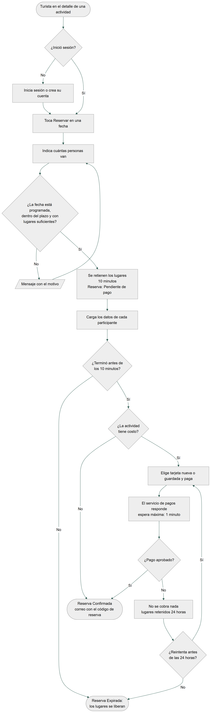
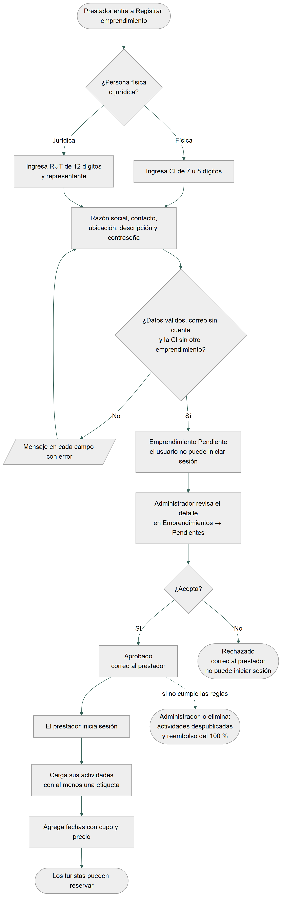
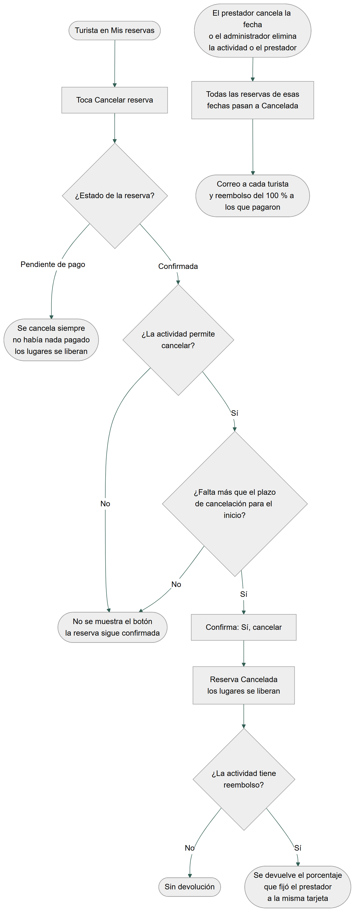
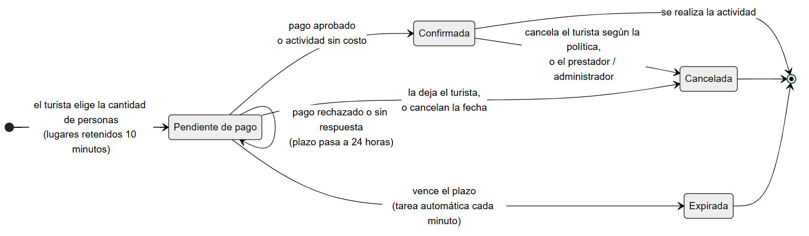
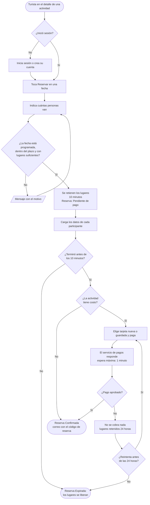
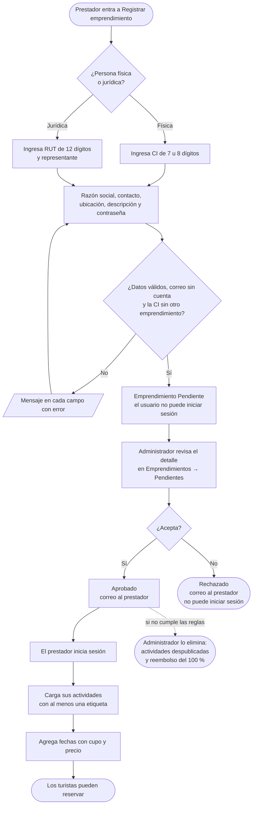
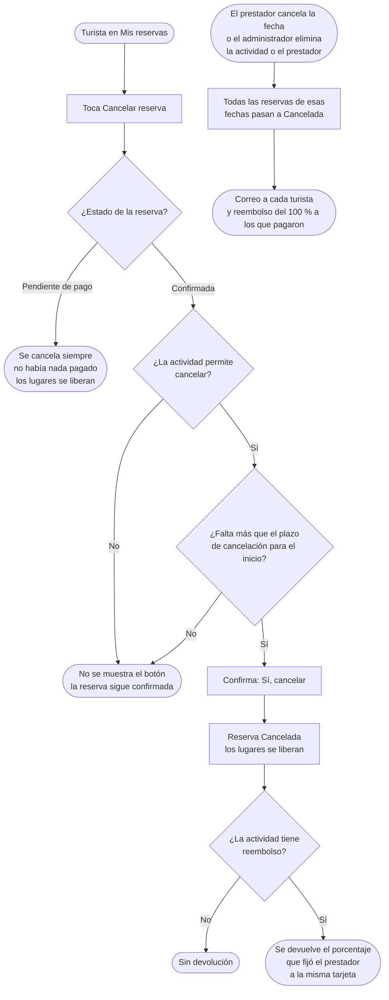
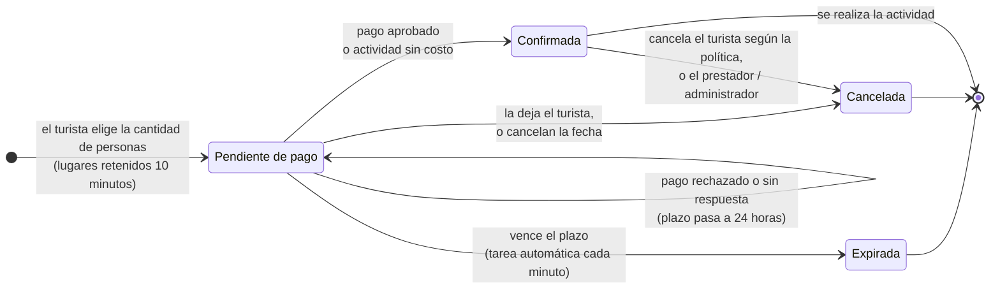

# Diagramas de flujo — Uruguay Mnatural

Muestran los pasos y las decisiones de los procesos principales, vistos desde el usuario. Para
ver qué clases intervienen en cada paso, consultá los
[diagramas de secuencia](Diagramas_de_secuencia.md).

Símbolos: los rectángulos redondeados son el inicio y el fin, los rectángulos son pasos, los
rombos son decisiones y los paralelogramos son mensajes que se muestran al usuario.

## 1. Reservar y pagar una actividad

Turista · CU-15 y CU-16 · reglas RN-15 (retención de 10 minutos), RN-19 (solo un pago aprobado
confirma) y RN-21 (24 horas para reintentar el pago).

## 2. Registro y aprobación de un emprendimiento

Prestador y Administrador · CU-01, CU-02, CU-10, CU-11 y CU-23.

## 3. Cancelar una reserva

Turista · CU-19, y cancelaciones del prestador o el administrador · CU-12, CU-23 y CU-24 · reglas
RN-26 (política de cancelación de la actividad), RN-27 y RN-28 (100 % de reembolso cuando no
cancela el turista).

## 4. Estados de una reserva

Resume los flujos anteriores: por qué estados pasa una reserva (`BookingStatus` en el código) y
qué la hace cambiar.

Las imágenes vectoriales (SVG) están en [`img/`](img/), con el mismo nombre.

Fuente de los diagramas (Mermaid, para editar)

