# Diagramas de secuencia — Uruguay Mnatural

Muestran, en orden, los mensajes que se mandan el usuario, el frontend y las clases del backend
(controlador → servicio → repositorio) en los casos de uso principales. Los nombres de clases,
métodos y rutas son los del código.

| # | Diagrama | Caso de uso (ERS) |
|---|---|---|
| 1 | [Iniciar sesión](#1-iniciar-sesión) | CU-04 |
| 2 | [Reservar una actividad](#2-reservar-una-actividad) | CU-15 |
| 3 | [Pagar una reserva](#3-pagar-una-reserva) | CU-16 |
| 4 | [Registrar y aprobar un emprendimiento](#4-registrar-y-aprobar-un-emprendimiento) | CU-01, CU-02 |
| 5 | [El prestador cancela una fecha](#5-el-prestador-cancela-una-fecha) | CU-12 |
| 6 | [Vencimiento automático de reservas](#6-vencimiento-automático-de-reservas) | CU-17 |

## 1. Iniciar sesión

La misma pantalla sirve para los tres roles. El backend devuelve un token JWT que el frontend
manda en cada pedido; `AuthInterceptor` controla el rol según el comienzo de la ruta.

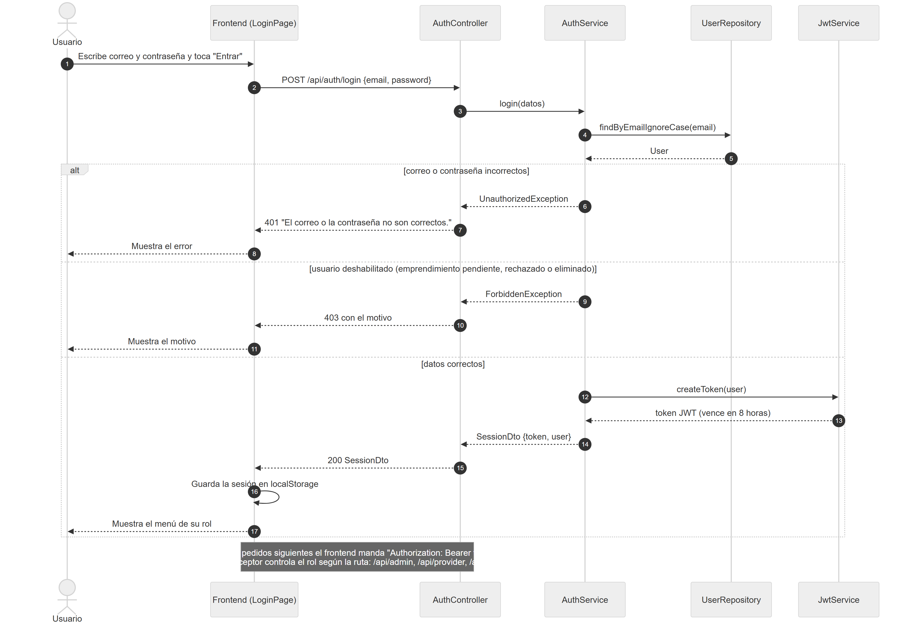

## 2. Reservar una actividad

La reserva funciona "como la de un avión": al elegir la cantidad de personas los lugares se
retienen 10 minutos. La fecha se lee con `SELECT ... FOR UPDATE`, así dos turistas que piden los
últimos lugares al mismo tiempo no pueden llevarse los mismos.

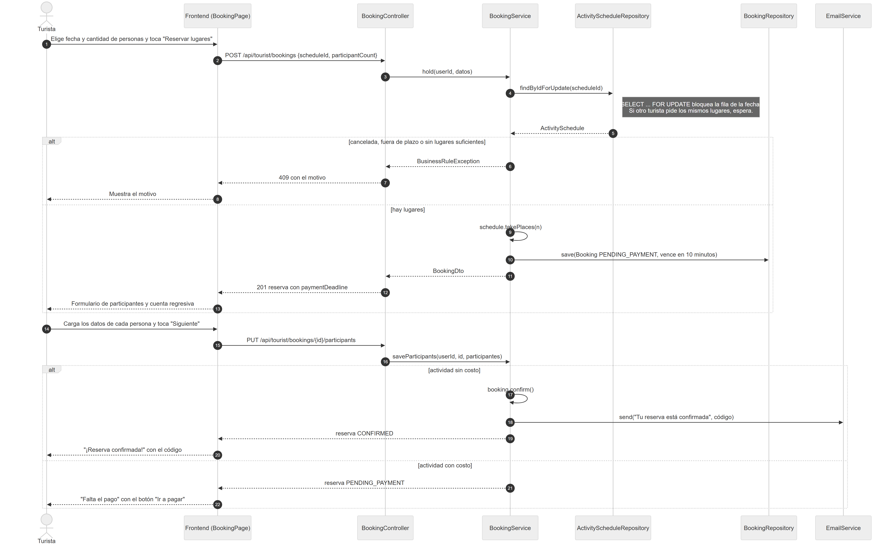

## 3. Pagar una reserva

El llamado a Mercado Pago puede demorar hasta un minuto, así que se hace **fuera de las
transacciones de la base**: una transacción corta antes (validar y extender el plazo a 24 horas)
y otra después (registrar el resultado y confirmar). Si mientras tanto la reserva dejó de estar
pendiente (por ejemplo, el prestador canceló la fecha), el pago aprobado se devuelve entero.

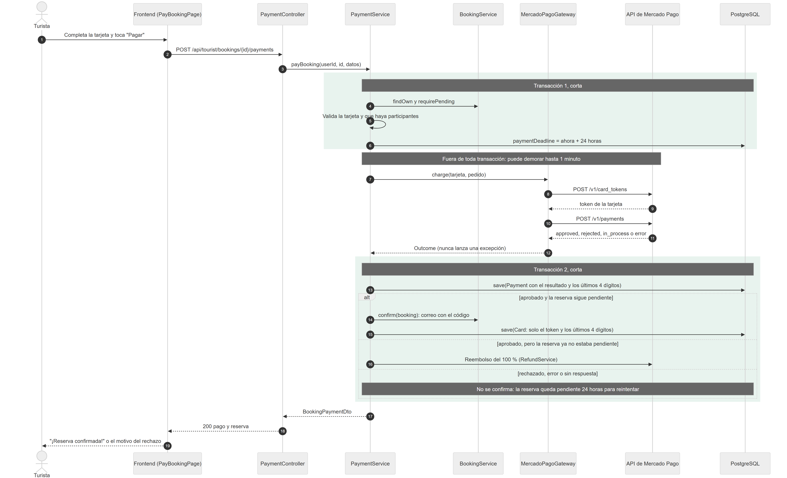

## 4. Registrar y aprobar un emprendimiento

El prestador se registra con el usuario deshabilitado. Solo puede iniciar sesión cuando el
administrador lo acepta.

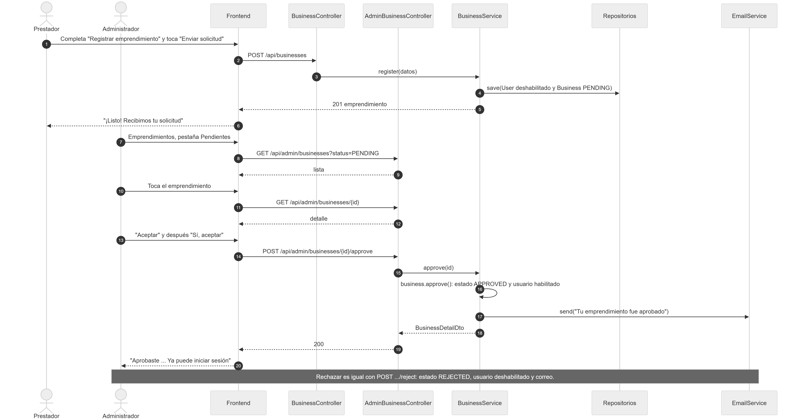

## 5. El prestador cancela una fecha

Se cancelan todas las reservas de la fecha, se avisa a cada turista por correo y a los que habían
pagado se les devuelve el 100 %. Eliminar una actividad (prestador o administrador) o eliminar un
prestador (administrador) hace lo mismo con cada fecha futura.

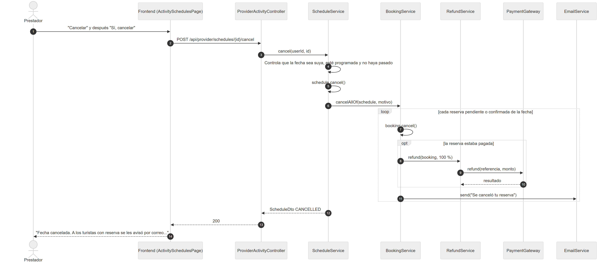

## 6. Vencimiento automático de reservas

Una tarea programada (`@Scheduled`) revisa cada minuto las reservas pendientes cuyo plazo venció,
las pasa a EXPIRED y devuelve los lugares a la fecha.

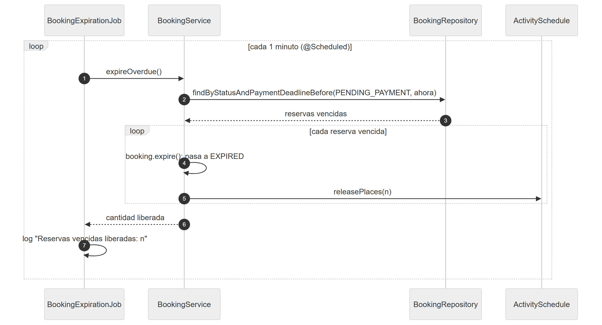

Las imágenes vectoriales (SVG) están en [`img/`](img/), con el mismo nombre.

Fuente de los diagramas (Mermaid, para editar)

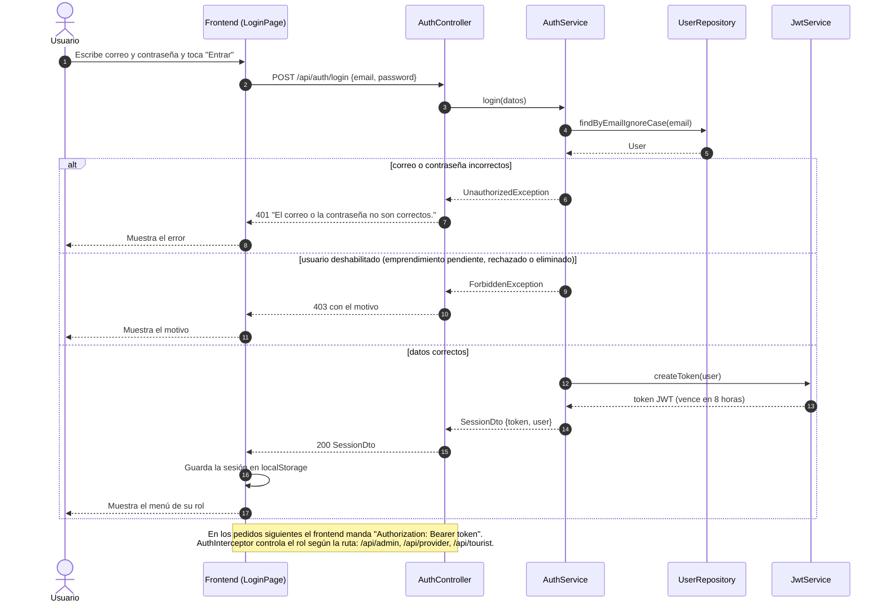

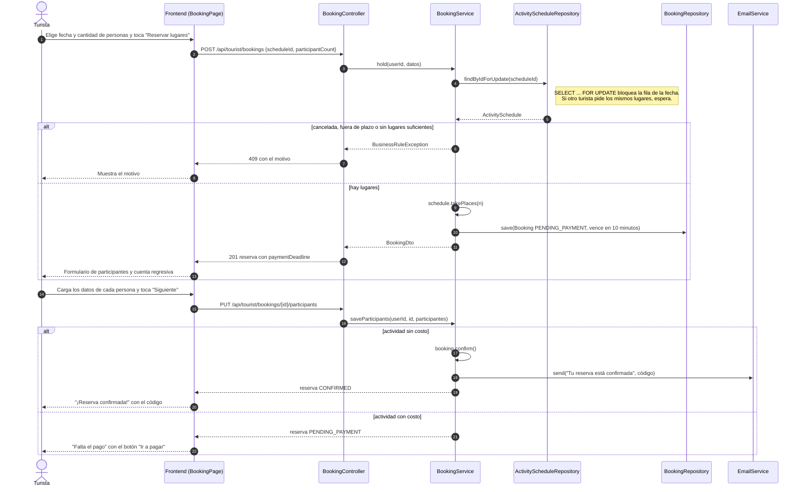

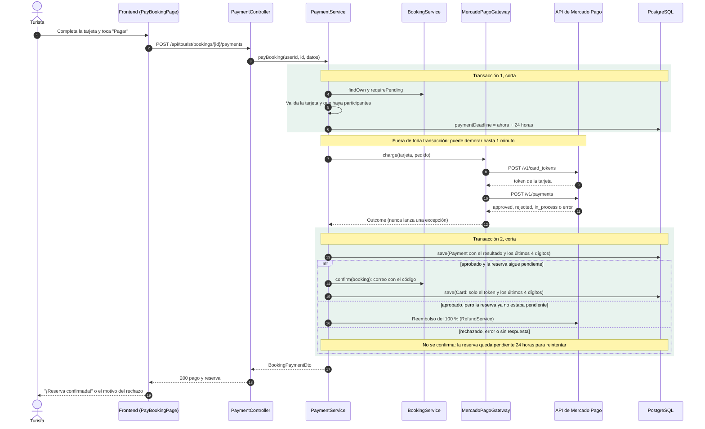

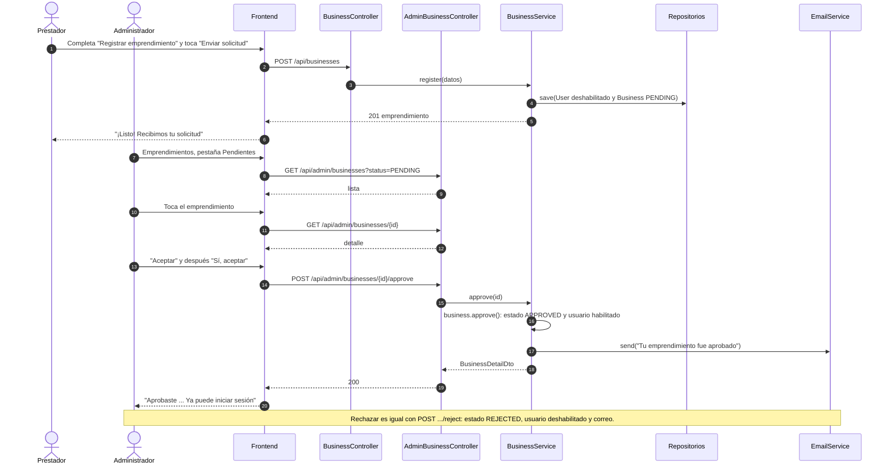

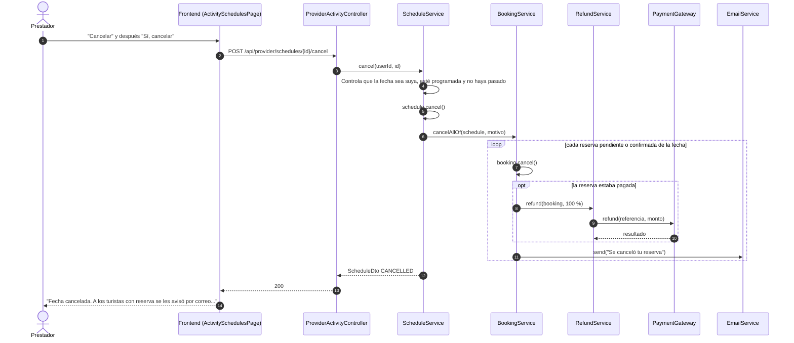

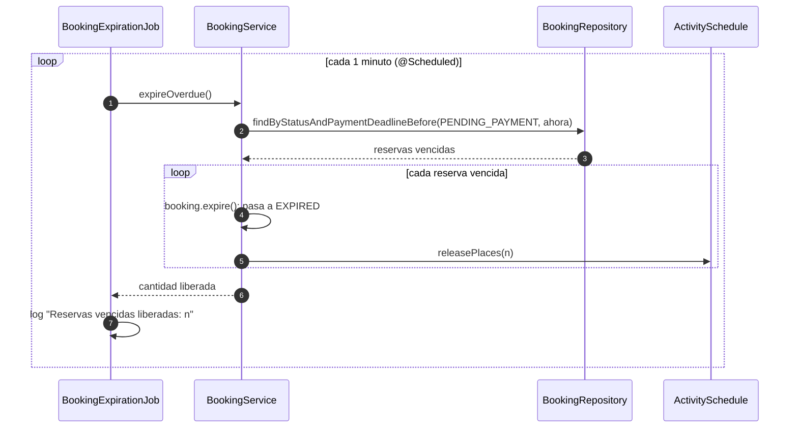

