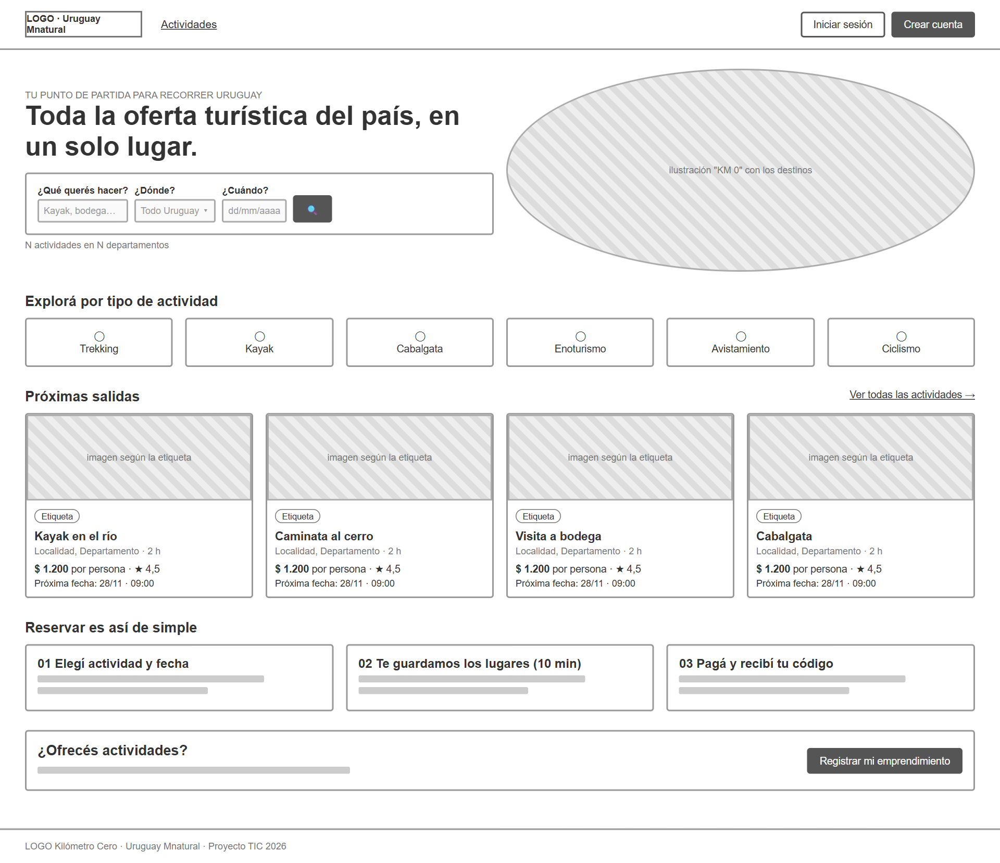
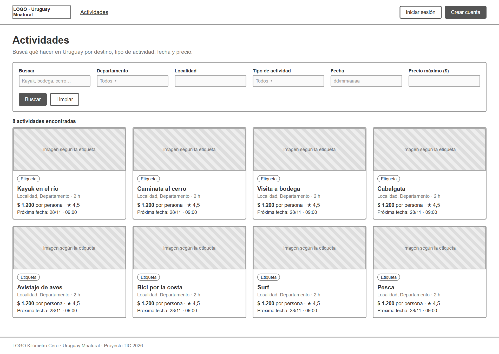
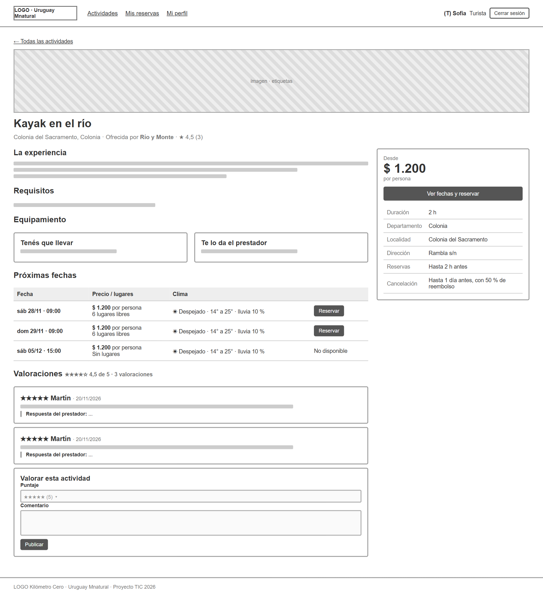
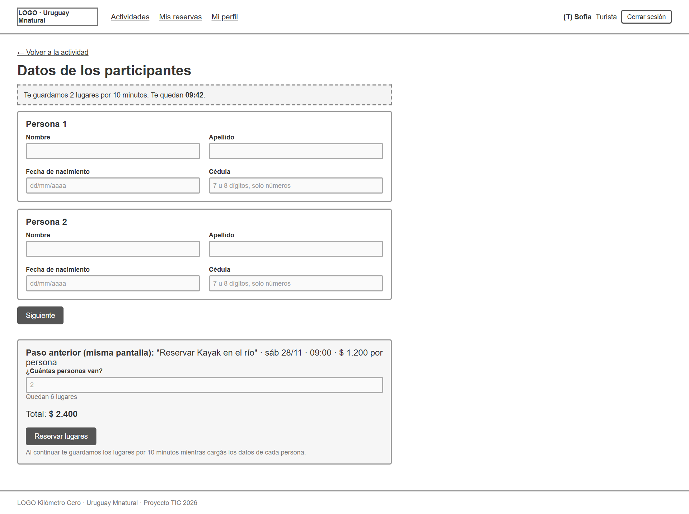
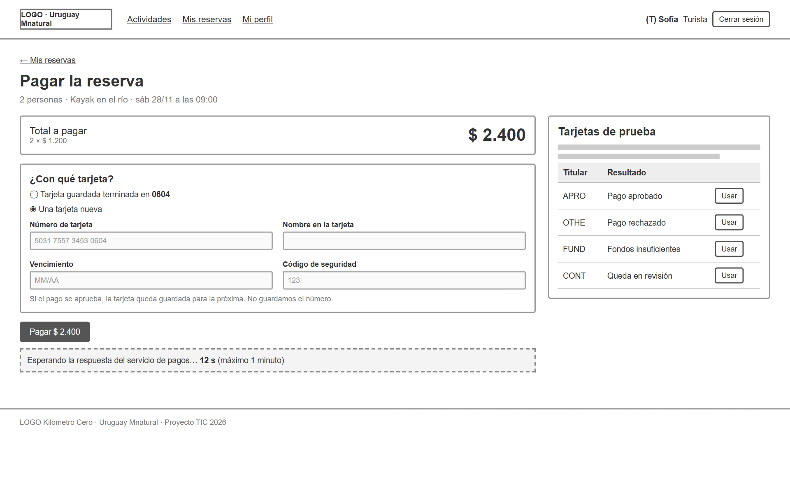
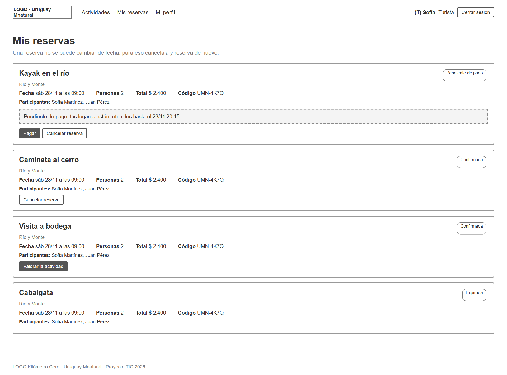
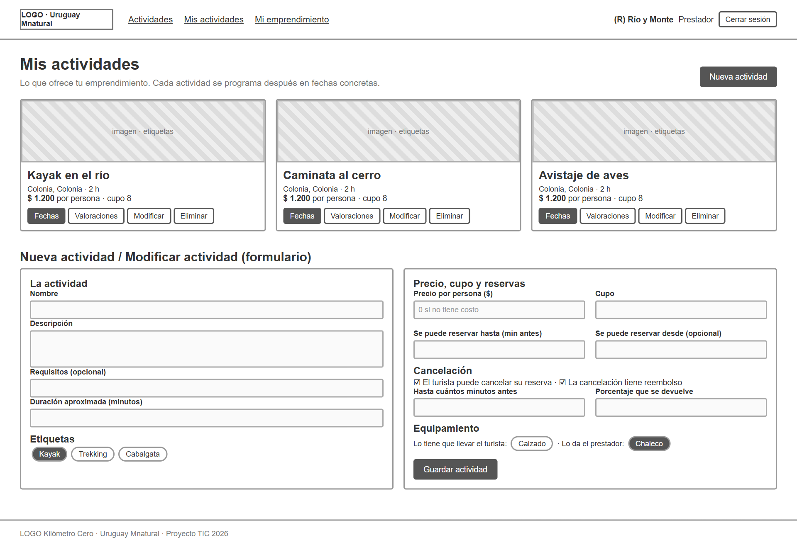
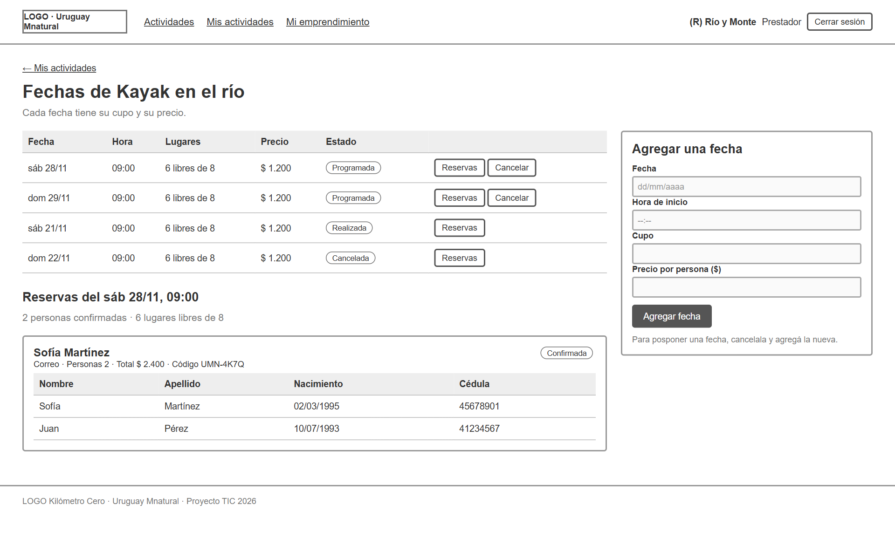
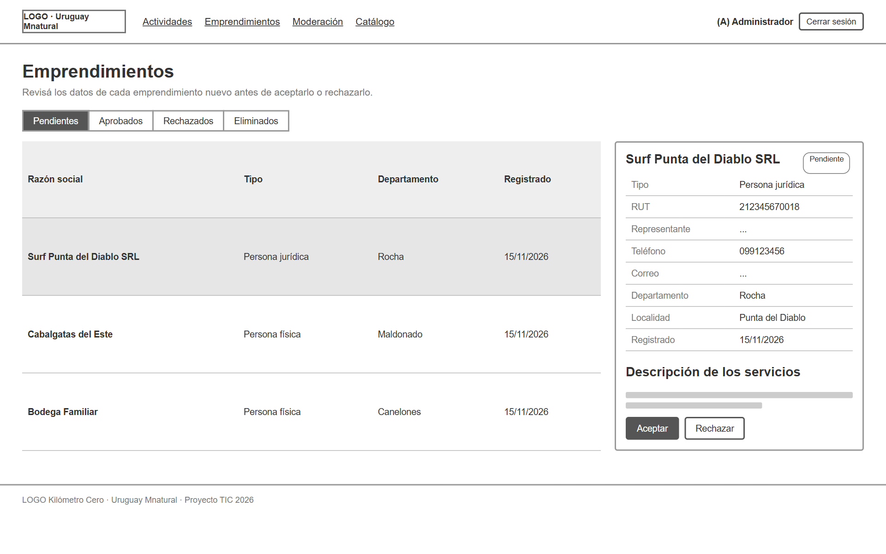
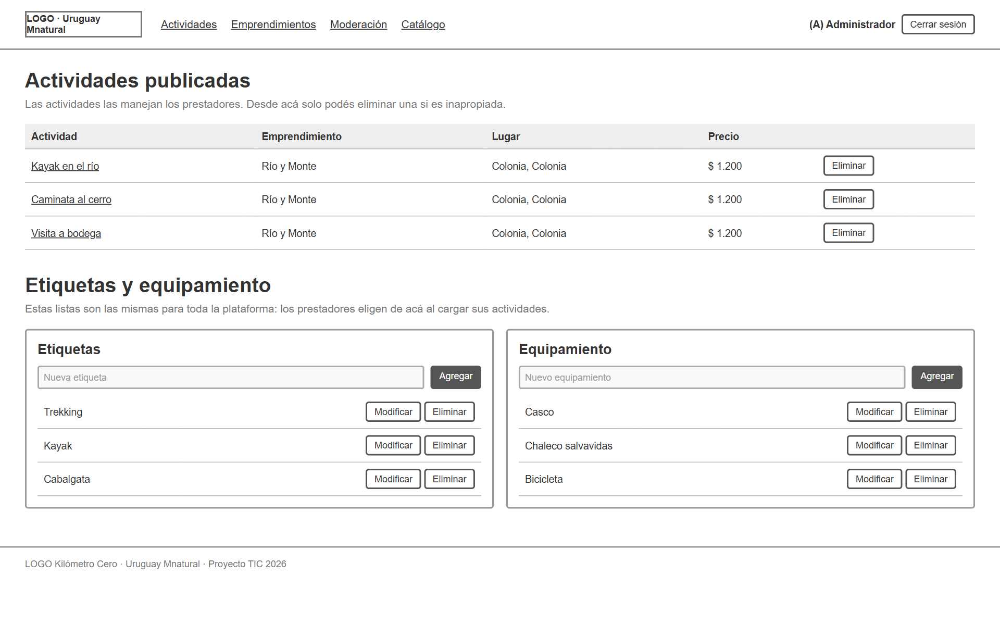

# Mockups — Uruguay Mnatural

Wireframes de baja fidelidad (en gris, sin colores ni imágenes reales) de las pantallas
principales, uno por pantalla y para los tres roles. Muestran **qué hay en cada pantalla y dónde
está**: menú, formularios, tablas, botones y mensajes. El diseño visual final (colores, logos de
Kilómetro Cero, ilustraciones) está en el frontend.

> Estos wireframes se dibujaron el 22/11/2026 a partir de las pantallas ya construidas, para
> documentarlas con el formato de mockup. Los textos son los mismos que usa la página; los datos
> (nombres, montos, fechas) son de ejemplo.

| # | Pantalla | Rol | Caso de uso |
|---|---|---|---|
| 1 | [Inicio](#1-inicio) | Visitante | CU-13 |
| 2 | [Actividades: búsqueda con filtros](#2-actividades-búsqueda-con-filtros) | Visitante | CU-13 |
| 3 | [Detalle de una actividad](#3-detalle-de-una-actividad) | Visitante / Turista | CU-14, CU-20 |
| 4 | [Reservar](#4-reservar) | Turista | CU-15 |
| 5 | [Pagar la reserva](#5-pagar-la-reserva) | Turista | CU-16 |
| 6 | [Mis reservas](#6-mis-reservas) | Turista | CU-18, CU-19 |
| 7 | [Mis actividades y formulario de actividad](#7-mis-actividades-y-formulario-de-actividad) | Prestador | CU-10 |
| 8 | [Fechas de una actividad y sus reservas](#8-fechas-de-una-actividad-y-sus-reservas) | Prestador | CU-11, CU-12, CU-22 |
| 9 | [Emprendimientos](#9-emprendimientos) | Administrador | CU-02, CU-23 |
| 10 | [Moderación y catálogo](#10-moderación-y-catálogo) | Administrador | CU-08, CU-09, CU-24 |

**Encabezado común:** logo (vuelve al inicio), menú con **Actividades** más las opciones del rol,
y a la derecha **Iniciar sesión / Crear cuenta** o el nombre del usuario con **Cerrar sesión**.

## 1. Inicio

Buscador rápido (qué, dónde, cuándo), tipos de actividad, próximas salidas, los tres pasos para
reservar y la invitación a registrar un emprendimiento.

## 2. Actividades: búsqueda con filtros

Seis filtros combinables y la grilla de resultados con la cantidad encontrada.

## 3. Detalle de una actividad

Descripción, requisitos, equipamiento, próximas fechas con el clima y el botón **Reservar**,
valoraciones con la respuesta del prestador y, a la derecha, el precio, la duración, la ubicación,
el plazo para reservar y la política de cancelación.

## 4. Reservar

Primero la cantidad de personas y el total; después, con los lugares retenidos, los datos de cada
participante y la cuenta regresiva de 10 minutos.

## 5. Pagar la reserva

Total a pagar, tarjeta guardada o nueva, el aviso de espera de hasta 1 minuto y, a la derecha, las
tarjetas de prueba.

## 6. Mis reservas

Una tarjeta por reserva con su estado y los botones que corresponden: **Pagar**, **Cancelar
reserva** o **Valorar la actividad**.

## 7. Mis actividades y formulario de actividad

Las actividades del prestador con sus botones, y el formulario para crear o modificar una
(etiquetas, precio, cupo, plazos, cancelación y equipamiento).

## 8. Fechas de una actividad y sus reservas

Tabla de fechas con lugares y estado, el formulario **Agregar una fecha** y el detalle de las
reservas de una fecha con la lista de participantes.

## 9. Emprendimientos

Pestañas por estado, la tabla y el detalle del emprendimiento elegido con **Aceptar** y
**Rechazar** (o **Eliminar prestador** si está aprobado).

## 10. Moderación y catálogo

Las actividades publicadas con **Eliminar**, y las listas de etiquetas y equipamiento para
agregar, modificar y eliminar.

---

Fuente: cada wireframe es un HTML en [`mockups/html/`](mockups/html/); la imagen se obtiene
capturando la página en Chrome con un ancho de 1280 px.
